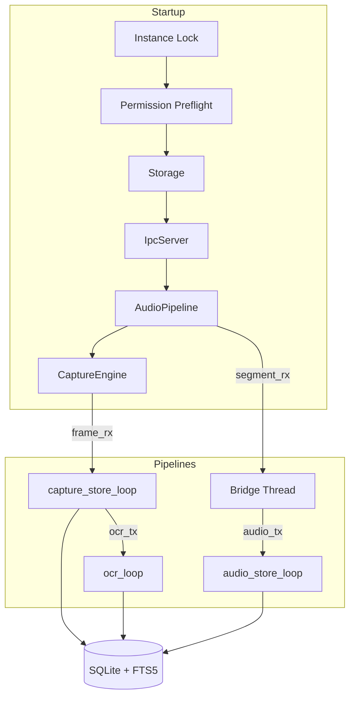

# Developer Guide — Chronicle Daemon

**Last updated:** 2026-08-22
**Component path:** chronicle-daemon/

## Overview

The daemon is Chronicle's background process. It captures screens, records
audio, runs OCR, and stores everything in SQLite with full-text search. It runs
headless, independent of the UI. The UI communicates with it over a
Unix socket. The current IPC surface is status-only.

The daemon is a Cargo workspace with six crates, each owning one concern. The
root binary (`chronicle-daemon`) orchestrates startup, wires crates into
pipelines, and handles shutdown.

## Architecture



**Key files:**

| File | Role |
|------|------|
| `src/main.rs` | Entry point, startup sequence, shutdown |
| `src/instance_lock.rs` | Single-instance lock on `chronicle.lock`, held until the runtime is dropped |
| `src/permissions.rs` | macOS TCC permission checks (Screen Recording, Microphone) |
| `src/pipeline.rs` | Async tasks: capture-to-store, OCR, audio-to-store, bridge thread |

### Startup Sequence

1. `logging::init(...)` — logging, defaulting to `warn,chronicle=info` when
   `RUST_LOG` is unset. It logs to stderr through env_logger, or to unified
   logging when `CHRONICLE_LOG_BACKEND=oslog`. On the unified-logging backend
   it also installs a panic hook that logs each panic's thread, location and
   message as a Fault before the default hook runs, because launchd discards
   stderr. `RUST_LOG` does not filter that line.
2. `StorageConfig::from_env()` — resolves the data root: `CHRONICLE_DATA_DIR`
   when it is set, otherwise the app group container under `HOME`. A relative
   override stops the daemon here, before anything is created. So does an
   empty or relative `HOME` when there is no override.
3. `create_group_container()` — asks macOS to create the app group container.
   Only this call can create it, and the login agent may start before the UI
   has ever run. The daemon ignores the returned URL.
4. `instance_lock::acquire()` — takes an exclusive lock on `chronicle.lock` in
   the data directory, before the Tokio runtime exists. Exits with status 0 and
   "another chronicle-daemon is already running" if another daemon holds it.
5. `checked_socket_path()` — fails startup when `ipc.sock` under the data
   root would be longer than the 103 bytes a Unix socket address holds.
6. `permissions::preflight()` — reads Screen Recording and Microphone and
   logs both. `run` seeds the supervisor's `sr_denied` gate from that read.
   The daemon keeps running and serves search. Capture
   starts once a helper read says the grant is there (CHR-96).
7. `Storage::open()` — opens/migrates SQLite database
8. `storage.sweep_orphans()` — the startup orphan sweep. It walks the media
   directory and deletes files that have no database row. It runs before
   capture starts, so this process writes no media while it walks. The
   instance lock from step 4 keeps a second daemon from sweeping at the same
   time.
9. `storage.status()` — primes the storage status snapshot so the first
   `Status` request doesn't see zeros. If the read fails, the snapshot keeps
   zero counters until a refresh succeeds. It also walks the media directory. A
   task refreshes the snapshot every 30 seconds after that.
10. `IpcServer::start()` — starts the Unix-socket status server. The sleep and
   wake observer is spawned earlier in `run()`, before it.
11. `AudioPipeline::create()` — prepares the audio handler, dispatch queue, and
   encoding thread used by ScreenCaptureKit audio callbacks. The microphone tap
   is built later, when the mic is first turned on.
12. `CaptureSupervisor::reconcile()` — starts the capture runtime, unless
   capture is paused in settings. The runtime is `CaptureEngine` plus
   `capture_store_loop` (Task A) and `ocr_loop` (Task B), started and stopped
   as one unit. A failed start is retried up to five times
   (`StartRetry::MAX_ATTEMPTS`), on a 5 to 30 second schedule. Before the
   first successful start, a failed start that may have left streams running
   exits the daemon with status 3.
13. Starts the audio bridge thread and spawns the drop reporter.
14. `provisioning::boot()` — loads the configured whisper model. This step is
    awaited, so a slow model load delays everything after it, including
    `audio_store_loop` and the event loop.
15. Spawns the rest of the background work: `transcribe_loop`, the
    transcription backfill, `audio_store_loop` (Task C), the storage status
    refresher, and the retention cleanup loop.
16. Runs the event loop until the shutdown signal (`SIGINT` from Ctrl-C or
    `SIGTERM`). It serves mic toggles, pause and resume, and sleep and wake.
    It also stops when the first capture start after a Screen Recording grant
    fails. The daemon then runs the full teardown and exits with status 4.
    launchd starts a fresh process that reads the grant at boot (CHR-96).
    It also stops if the permission monitor task ends. The daemon then exits
    with status 3, and launchd starts a fresh process.

### Channel Topology

```text
CaptureEngine → [frame_rx: mpsc] → Task A (capture_store_loop)
                                        ↓ encode HEIF, insert DB
                                        ↓ try_send (lossy, best-effort)
                                   [ocr_tx: tokio::mpsc(1024)] → Task B (ocr_loop)
                                                                      ↓ Vision OCR
                                                                      ↓ update DB

AudioPipeline → [segment_rx: std::sync::mpsc] → Bridge Thread
                                                     ↓ blocking_send (lossless)
                                               [audio_tx: tokio::mpsc(64)] → Task C (audio_store_loop)
                                                                                 ↓ move file, insert DB
```

Capture-to-OCR is lossy (`try_send`) because OCR is slow and screenshots are
supplementary. Audio is lossless (`blocking_send`) because dropping a 30-second
segment means data loss.

### Shutdown

Triggered by `SIGINT` (Ctrl-C) or `SIGTERM`, by a failed first start after a
grant, or by the permission monitor stopping (item 16). Each enters the same
ordered teardown that cascades through the system. After a failed first start
after a grant, an exit watchdog ends the process with status 4 if the teardown
takes longer than 15 s:

1. `supervisor.shutdown()` — stops SCStream and joins the store/ocr tasks
2. `audio_pipeline.stop()` — drops the audio handler and flushes the encoding thread
3. `bridge_handle.join()` — bridge thread drains and exits, closing `audio_tx`
4. `await` all async tasks — they exit when their input channels close, except
   the backfill task, which stops on the cancellation token
5. `join_cleanup_task(cleanup_handle, CLEANUP_GRACE)` — the retention cleanup
   loop, joined last so it keeps winding down while steps 1-4 drain

Of the five steps above, only retention cleanup and the backfill task in step 4
do not drain on a closing channel. They watch the cancellation token instead.
The storage status refresher watches the same token. It is spawned detached. No
step joins it.
`cancel.cancel()` sets that token. It fires after the provisioning wait and the
channel closes, and before every unbounded step. The batch loop checks the
token before each batch and again after each commit. An in-flight run therefore
ends at the next batch boundary instead of running to completion.

`CLEANUP_GRACE` is not a deadline. When it expires the join logs that cleanup
is running long, then keeps waiting. Two other waits do force work to stop.
The provisioning wait, earlier in teardown, aborts its task. `DRAIN_GRACE` in
step 4 raises `stop_transcription`, and the transcribe loop then abandons what
is still queued. `CLEANUP_GRACE` is the only one whose expiry raises nothing,
because `cancel.cancel()` already raised its signal.

On a normal return, `instance_lock::run_holding` drops the Tokio runtime and
only then releases `chronicle.lock`. Dropping the runtime waits for every
running `spawn_blocking` task. Storage work still in flight finishes while the
lock is held. A new daemon cannot start until that work is done. The two
`exit(3)` paths in `run` skip this. The process ends with its blocking work
still running. The kernel releases the lock when the process exits.

## Key Concepts

**Two-process architecture:** The daemon and UI are separate
processes. If the UI crashes, capture continues. The app registers the
daemon as a login agent; see Installing in the README.

**Async OCR (and future transcription):** Capture and storage are the
critical path. OCR already runs behind the main ingestion loop, and any future
transcription work should follow the same pattern.

**Permission preflight:** Screen Recording is required for all ScreenCaptureKit
functionality (both screen capture and audio). Without it the daemon runs with
capture off. The permission monitor (`permission_monitor.rs`) re-reads both
permissions through the `--permission-status` helper (ADR-022). It reads
every 2 s while Screen Recording is missing or unconfirmed. It reads every
5 s once Screen Recording is granted.
It does not read while the Mac is asleep or capture is paused. Microphone is
optional. Mic capture is off by default and is toggled from the UI.

## Diagnosing a Microphone

Start here when a microphone records silence, near-silence, or empty
transcripts. The daemon logs the device's identity and native input format
once, when it installs the tap:

```text
[2026-08-22T22:02:06Z INFO  chronicle_audio::microphone] microphone tap installed (capture starts on mic-on): device_name="Yeti Stereo Microphone" device_uid="AppleUSBAudioEngine:Generic:Blue Microphones:<serial>:1", 2 ch, 48000 Hz, interleaved=false, format=f32
```

It reports the input device you selected — its name and CoreAudio UID — then
channel count, sample rate, whether samples are interleaved, and the sample
format.

**The two halves can describe different CoreAudio objects.** The device fields
name the input device you selected in System Settings. The format numbers come
from whatever `AVAudioEngine` bound, which is usually a private aggregate
wrapping the default route rather than the device itself.

For a plain microphone these agree. **For an aggregate you built in Audio MIDI
Setup they will not**, and that is expected rather than a symptom: CoreAudio
flattens your aggregate into its own, so the numbers come from one member while
the name is the aggregate. A channel count that disagrees with what Audio MIDI
Setup shows for the named device is this, not a fault.

**Redact the UID before you paste this line anywhere public.** A real
`AppleUSBAudioEngine:` UID carries the device's hardware serial in its
**second-to-last** segment — the trailing one is an interface index, not a
secret. Replace the serial with `<serial>` and say you did; a comparison still
holds with both sides redacted. `mheuss/chronicle` is a public repository.

**A `2 ch` mic is the usual reason audio comes back quiet.** The converter is
built with no `channelMap`, so a 2-to-1 conversion selects channel 0 and
discards channel 1 — it does not mix them. If the device puts most of its level
on channel 1, that level never reaches the recording. CHR-24 measured this on a
Blue Yeti: its channel 0 runs 7.7-7.9 dB below its channel 1, and the converter
output was bit-identical to channel 0. A mic that duplicates its channels, like
the EMEET SmartCam, is unaffected.

Both measured devices reported `interleaved=false, format=f32`, and that is the
layout the regression test pins. A stereo device reporting some other layout was
not measured, so read those two fields in the line above before assuming this is
your problem. Quiet audio from a `1 ch` device is a different problem, and this
is not it.

You will see the line in a normal run once the mic is turned on. The daemon
defaults to `warn,chronicle=info`, so no `RUST_LOG` is needed:

```bash
export CHRONICLE_DATA_DIR="$HOME/chronicle-dev"
cd chronicle-daemon
cargo run --bin chronicle-daemon
```

The variable is required here. macOS refuses a daemon started from Terminal in
the App Group container. See Data location in the README.

The `cargo run` command does not exit on its own. The shell waits on `cargo`.
Press Ctrl-C once you have the line.

The bundled UI can't reach this daemon's socket, so turn the mic on from a
second shell:

```bash
printf '{"type":"set_mic_enabled","enabled":true}\n' | nc -U -w 1 "$HOME/chronicle-dev/ipc.sock"
```

This command never asks for mic access. The daemon uses the grant of the
terminal that launched it, so that terminal must already have access. Without
it, the log shows `mic gate: refused start` and neither line below.

Watch for one of two lines, not just the first. When `MicrophoneCapture::new`
fails there is no tap install at all — `ipc_handler.rs` logs
`microphone toggle failed: {reason}` instead. Waiting only for `tap installed`
in that case looks identical to "the log is missing" while the actual
explanation scrolls past.

If you do set `RUST_LOG`, it replaces the default filter wholesale rather than
adding to it, and that catches people out. `RUST_LOG=chronicle_audio=debug` is
**not** additive: `env_filter` returns false for any target no directive
matches, whatever its level, so a lone crate directive silences every *other*
crate — `chronicle_daemon`'s own log lines included. A fatal startup error
still prints to stderr. Lead with a level for everything else, as in
`RUST_LOG=warn,chronicle_audio=debug`.

Four things to know before you trust what you read:

- **A second daemon on the same data directory will not start.** The daemon
  locks `chronicle.lock` in its data directory before it opens the database. A
  newcomer that finds the lock held exits with "another chronicle-daemon is
  already running". It exits *before* it opens the database or reaches the tap
  install. You get no line at all, not an error about the microphone. The
  running daemon is another dev daemon on the same `CHRONICLE_DATA_DIR`. The
  login agent uses the group container, so it has its own lock and does not
  block a dev daemon. The lock is per data directory, so a different data
  directory has its own lock and its own daemon.
- **The system log hides the device.** Under the agent, log lines go to the
  unified log with the microphone's name and UID replaced by `redacted`. Run
  the daemon by hand to see them.
- **Restart between devices.** `MicrophoneCapture` and its converter are built
  when the mic is turned on. Turning the mic off drops them. Pausing capture
  keeps them. Changing the default input while the mic is on leaves the
  converter built for the previous device. So does changing it while capture is
  paused with the mic on.
- **The line appears before capture starts.** The tap is installed when the mic
  is turned on. This happens just before the engine starts. Seeing this line
  shows the engine was built. It does not show that audio was recorded.

Cross-check the numbers against **Audio MIDI Setup** (`open -a "Audio MIDI
Setup"`), which shows each device's format. System Settings → Sound → Input only
tells you which device is selected.

## How to Modify

### Adding a new pipeline stage

1. Define a channel in `main.rs` (decide bounded size and lossy vs lossless)
2. Write the async loop function in `pipeline.rs` following the existing pattern
3. Spawn it with `tokio::spawn` in `main.rs`
4. Add shutdown handling (tasks exit when their input channel closes)

### Adding a new permission check

1. Add a status enum and FFI call in `permissions.rs`
2. Add a `--permission-status` arm for it. Decisions after boot then use a fresh read (ADR-022)
3. Add a `PermissionName` for it, and have `permission_monitor` read it on each tick
4. Add its state to `PermissionsStats` in `crates/ipc`, and decode it in the UI's `Permissions`
5. Decide whether it gates capture. A gate belongs in `CaptureSupervisor`, never in an exit from `preflight()`

### Adding a new crate to the workspace

1. Create the crate under `crates/`
2. Add it to `chronicle-daemon/Cargo.toml` workspace members and dependencies
3. Wire it into `main.rs` and/or `pipeline.rs`

## Dependencies

### Workspace Crates

| Crate | Purpose | Key External Deps |
|-------|---------|-------------------|
| `chronicle-capture` | Screen capture via ScreenCaptureKit | `objc2-screen-capture-kit`, `objc2-app-kit`, `core-graphics` |
| `chronicle-audio` | Audio capture + Opus encoding | `objc2-avf-audio`, `objc2-audio-toolbox`, `objc2-core-audio`, `objc2-screen-capture-kit`, `opus`, `ogg` |
| `chronicle-storage` | SQLite + FTS5 storage engine | `rusqlite` (bundled), `r2d2` |
| `chronicle-ocr` | Text extraction via Vision framework | `objc2-vision` |
| `chronicle-transcription` | Local speech-to-text via whisper.cpp | `whisper-rs`, `opus`, `ogg`, `sha1` |
| `chronicle-ipc` | JSON over Unix socket status server | `serde`, `serde_json` |

The daemon binary depends on every crate above, `chronicle-transcription`
included: `provisioning.rs` loads and calls it, and `transcription-metal` is a
default feature. At runtime the crates are independent of each other with two
exceptions: `chronicle-capture` depends on `chronicle-audio`, and
`chronicle-storage` depends on `chronicle-ipc`. Test builds add
two more edges. `chronicle-transcription` takes `chronicle-audio` as a
dev-dependency for `OggOpusEncoder`. It takes `chronicle-storage` as one for
`data_root`. So `cargo test -p chronicle-transcription` builds both.

### What depends on the daemon

The Swift UI (`chronicle-ui`) communicates with the daemon over a Unix socket.
It does not depend on the daemon as a library. It talks to it over the IPC
protocol. It also runs the bundled daemon binary as
`chronicle-daemon --permission-status microphone` for a fresh permission read.

## Building

```bash
cd chronicle-daemon
cargo build            # debug
cargo build --release  # release
```

The repo-root `.cargo/config.toml` carries four things the binary needs:

- the `/usr/lib/swift` rpath, without which any binary touching
  ScreenCaptureKit crashes at launch with "no LC_RPATH's found"
- `CMAKE_POLICY_VERSION_MINIMUM=3.5`, without which the vendored Opus build in
  `audiopus_sys` fails to configure under CMake 4
- `MACOSX_DEPLOYMENT_TARGET=27.0`, so the binary and its C and C++ dependencies
  all target macOS 27
- `CMAKE_SYSTEM_NAME=Darwin`, which turns off whisper.cpp's host-CPU tuning so
  the binary runs on every Apple Silicon chip, M1 included

Cargo finds that file by walking up from the directory it is invoked in, so it
applies from the repo root, `chronicle-daemon/`, and anywhere below. Building
from the root with `--manifest-path chronicle-daemon/Cargo.toml` works too.

The CMake builds in `whisper-rs-sys` and `audiopus_sys` don't rerun when the
last two settings change. A checkout that built before they existed keeps
linking the old objects. Clear them once per profile:

```bash
cargo clean -p whisper-rs-sys -p audiopus_sys            # debug
cargo clean -p whisper-rs-sys -p audiopus_sys --release  # release
```

## Testing

### Unit tests

```bash
cd chronicle-daemon && cargo test --workspace
```

All crates have unit tests. No special setup needed for this command. The SOP
`test_command` runs the Swift tests after it.

### Integration tests

Capture and audio integration tests require real macOS permissions and are
marked `#[ignore]`. Run them with:

```bash
cd chronicle-daemon && cargo test --workspace -- --ignored
```

Grant Screen Recording and Microphone permissions to your terminal app first.
The real-model transcription tests also need `CHRONICLE_DATA_DIR` set to an
absolute path. Its `models/` directory must hold `ggml-base.bin`. macOS refuses a terminal
process inside the App Group container, so the default root does not work here.

Most of the Vision OCR tests in `chronicle-ocr` and `pipeline.rs` are
`#[ignore]`d too. They need no permissions, but Vision fails on GitHub's hosted
runners, so they only run with `--ignored`. `extract_text_never_panics` still
runs in CI. There it only covers Vision's error path.

### Continuous integration

`.github/workflows/ci.yml` runs on every pull request and every push to `main`.
It uses GitHub's `xcode-27` macOS runner. The `rust` job runs
`cargo fmt --all --check`, then clippy and `cargo test --workspace`, both with
`--locked`. The `swift` job runs `swift build` and `swift test` with
`--only-use-versions-from-resolved-file`.

The `#[ignore]`d tests do not run in CI. Before you merge a PR, run them
locally with `cargo test --workspace -- --ignored`, as shown above. CHR-175
tracks running them on a self-hosted runner instead.

### Linting

```bash
cd chronicle-daemon && cargo clippy --workspace --all-targets -- -D warnings
```

The SOP gate runs workspace clippy with `--all-targets -- -D warnings`.
